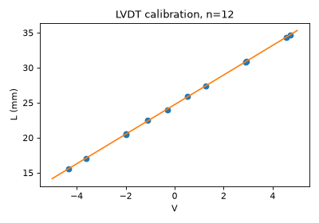
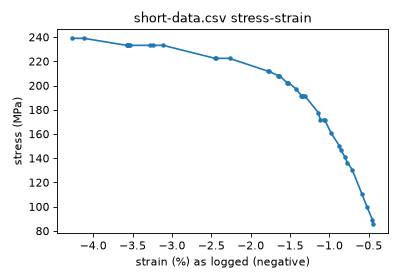
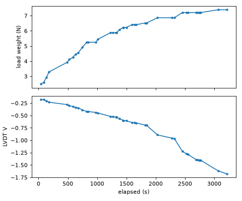

# Preliminary analysis of local lab data (short-run run)
Status: draft

Caveat: the L0 = 0.08313 m short-run run is believed unreliable (clamp
slip); treat every number here as unvalidated.

Scope: what the one available LCTT file does and does not show. All
numbers were recomputed with numpy from the file itself (not copied from
its derived columns) unless stated. Provenance (real run or simulation) is
unknown; see open-questions.md.

## 1. File facts

- Dated 2026-11-03 11:48:20, 152 lines: 1 title + metadata block + blank
  line + header + 41 data rows. 32 columns, matches domain.md section 4.
- operator and description blank. Averaging duration 10 s.
- Tare V = 0, U Tare = 0, Tare N = 0: **no tare was recorded**.
- Calibration: 12 points, slope 2.11458E-3 m/V, intercept 2.4729E-2 m,
  r^2 0.99989858, U95 slope 1.5006E-5 m/V (0.71 %). Refit with numpy
  reproduces slope, se, r^2 to 6 digits.
- Specimen: d = 2.019E-4 m (A = 0.03201566 mm^2), L0 = 0.08313 m (U inst
  0.0005 m), hanger 0.2563 N. All typed U values 0 and readings n = 0, so
  typed values are used; U F = 0 and U stress = 0 in every row.
- Rows: elapsed 38.7 s to 3211 s; gaps 4.4 to 308 s (median 48 s). These
  are manual Log single point rows, not the 20 rows/s stream.
- E fit stored in header: -3.2817E9 Pa, U95 6.716E8, r^2 0.7147, n = 41,
  window = all.

## 2. Calibration (img/cal_fit.png)

- V spans -4.33 to +4.72 V (inside the 4.9 V light) giving 15.6 to 34.7 mm.
  The 12 points cover about 19 mm.
- Largest residual 131 um (about 0.4 % of span). r^2 passes the 0.9999
  guide threshold only barely (0.99990).
- The "lengths" are absolute heights (intercept 24.7 mm), not
  displacements. Only the slope is used downstream, so this is harmless
  but see open-questions.md Q1.

## 3. Recomputation check

- strain: recomputed dL/L0 = (slope dV)/L0 agrees with the file to 1.7E-11.
- stress: F/A agrees within 0.05 Pa.
- F ranges 2.7453 to 7.6496 N; stress 85.7 to 238.9 MPa. 20 distinct load
  levels; load is monotonic non-decreasing; steps 0.11 to 0.63 N.
- The first logged row is already at 2.489 N added plus the hanger. The
  unloaded state is not in the file, so strain is relative to an unknown
  zero (tare = 0 means dV is just V, so strain includes the arbitrary
  offset of the core at the time).

## 4. Sign problem (img/stress_strain.png)

dV runs from -0.176 V to -1.677 V while stress rises, so logged strain is
**negative** with positive stress. Consequently the logged E secant
(about -1.9E10 to -5.6E9 Pa) and E fit (-3.28 GPa) are negative. The
guide's "Strain is negative" entry applies: either the LVDT is mounted so
stretch moves the core toward negative V, or the cal lengths ran opposite.
Here the cal slope is positive (+2.11E-3 m/V), so it is the mounting
direction. Using -strain: total |strain| change 0.0382, E fit +3.28 GPa,
r^2 0.715.

## 5. Modulus by window (using -strain)

| rows | E (GPa) | r^2 |
|---|---|---|
| 0-5 | 16.6 | 0.998 |
| 0-10 | 14.2 | 0.992 |
| 10-20 | 7.27 | 0.981 |
| 20-30 | 2.25 | 0.939 |
| 30-41 | 0.82 | 0.869 |

The tangent modulus drops continuously from about 16 GPa to about 1 GPa.
Even the stiffest window is 7 to 8 times below the 110-130 GPa the guide
expects for annealed copper. The curve has no linear elastic region; the
global E fit (r^2 0.71) is a meaningless average over a curved response.

## 6. Time dependence (img/time_series.png)

Rows logged at the same load keep moving:

| load (N) | dV/dt (mV/s) | strain rate (1/s) |
|---|---|---|
| 5.2482, 5.8814, 6.2252 | about -0.14 | about -3.6E-6 |
| 6.4102 | -0.09 | |
| 6.8645 | -0.26 | |
| 7.2083 (8 rows, 315 s) | -0.60 | -1.5E-5 |

At 7.2083 N strain grew by 0.00464 in 315 s (0.0013 at +71 s, 0.0016 at
+95 s, 0.0042 at +234 s). The per-row standard error of a 2500-sample mean
is 0.69 mV (1.75E-5 in strain), so these drifts are well above
measurement noise.

## 7. Noise

Per-block std dev 0.0345 V (range 0.0316 to 0.0365, SD 0.0011),
independent of load; about 73 um per sample. Logged U LVDT V = 2 s =
0.069 V is therefore about 100 times the 0.69 mV standard error of the
block mean, so logged U strain (about 1.7E-3) is dominated by per-sample
scatter, not by the precision of the mean. This is the as-specified class
rule ("N > 200 is 2 Sx") but is a design question for the port.

## 8. What cannot be concluded

- Material E: the data do not show an elastic regime, so no valid E,
  yield stress or ultimate can be extracted. Could be already plastic at
  the first load, slack or wire seating, clamp slip, creep, or a
  mis-set L0 (0.08313 m vs the guide's typical 0.5 m); the file cannot
  separate them.
- Creep versus slip: both give strain growth at constant load. No
  unloading rows, so recovery (viscoelastic or elastic) is unobservable.
- Absolute strain: no tare, no zero-load row.
- Uncertainty budgets: typed U are zero, so reported U stress and U F
  are zero and U strain reflects only voltage and calibration terms.
- Whether the file is a real run or a software simulation.
- Rate effects: load steps were applied at irregular times (4 to 308 s),
  so rate dependence is confounded with step size and dwell.
