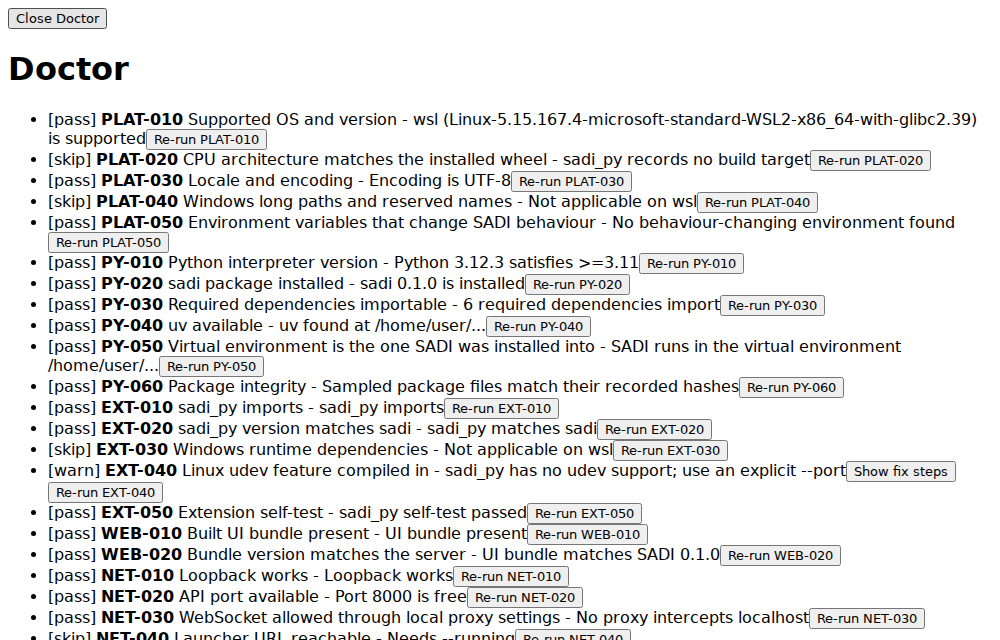
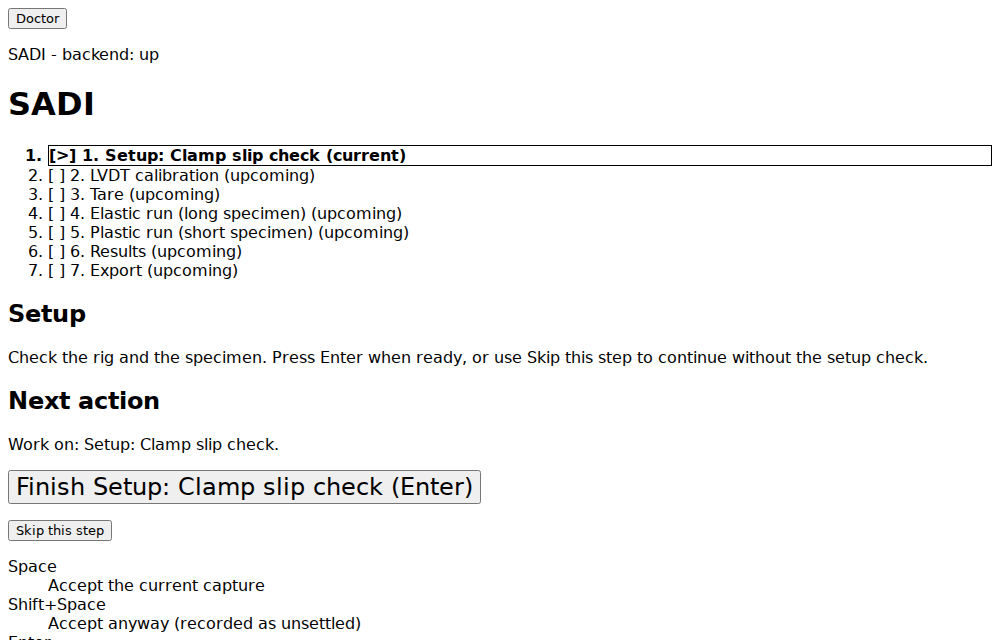
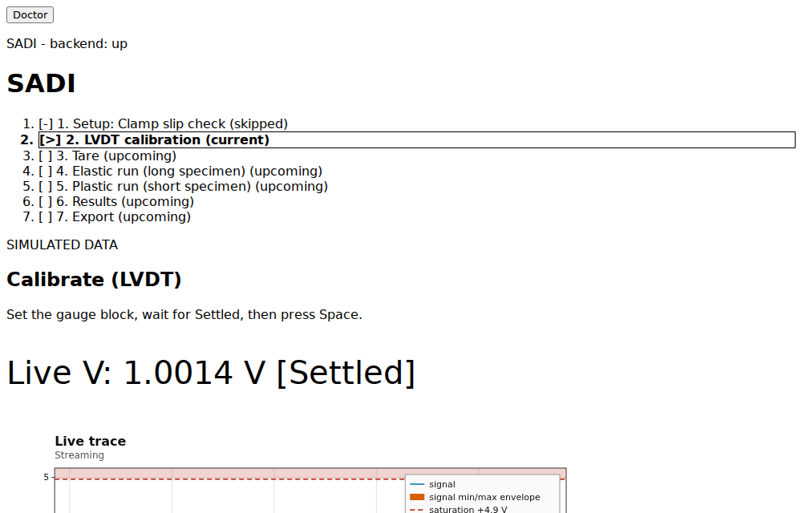
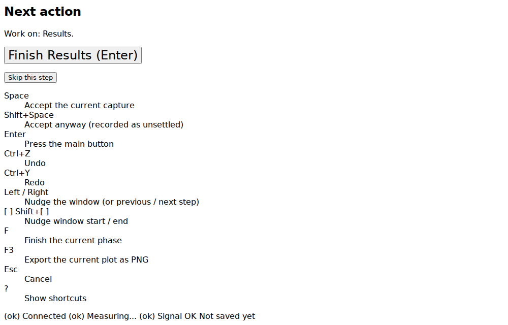
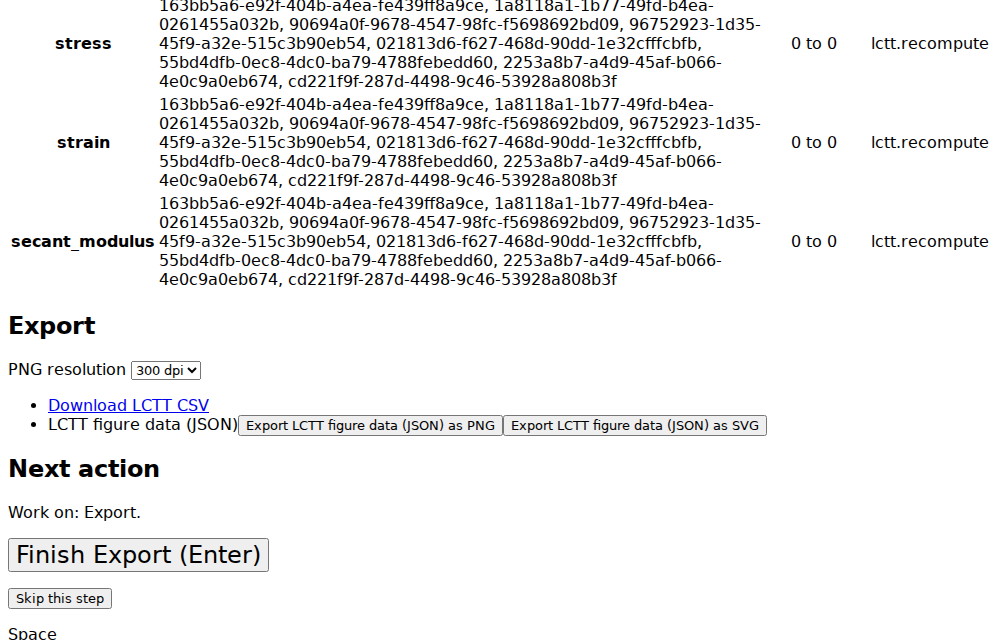

# User guide: screenshots

Status: current

Parent: [Documentation index](index.md). Companion to the [user guide](user-guide.md). Ticket: ~921XDAW.

The screenshots below come from `sadi --sim` (simulated data, so values are illustrative). They
are stored under `docs/img/ui/` and regenerated by `web/docs-shots/screenshots.spec.ts`, which is
skipped unless `SADI_SCREENSHOTS=1` is set:

```
cd web && SADI_SCREENSHOTS=1 npx playwright test -c docs-shots/playwright.config.ts
```

It reuses the backend fixture of the [e2e](e2e.md) suite.

## Doctor

The Doctor screen lists the environment checks (platform, Python, extension, web bundle, network) with
a status per check and a Re-run button. Open it from the Doctor link in the top bar.



Caption: this capture was taken on a simulator build, so the EXT-040 udev check shows a warning
(sadi_py has no udev support) and keeps its "Show fix steps" button. That is the real simulator state.
The fix steps list the udev rule to install and the reload commands; on a hardware build with udev
support the check passes and the button is absent. <!-- frob:ticket 01M6X9EHYXYSA7QP4N7PDT1RZ6 -->

## Setup

The step rail lists Setup, LVDT calibration, Tare, Elastic, Plastic, Results and Export.



## Capture

Calibration, tare and the specimen runs share one capture screen: wait for the readout to show
Settled, then press Space (procedure: [user guide](user-guide.md) section 3).



## Results



## Export

The export step shows the results panel and the CSV and figure downloads
([export screen](web/export-screen.md)).


